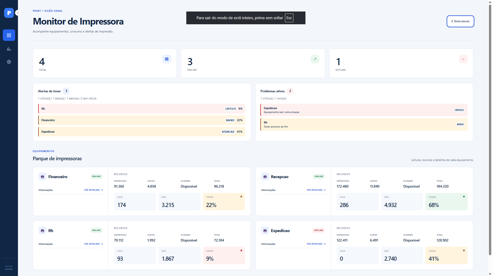
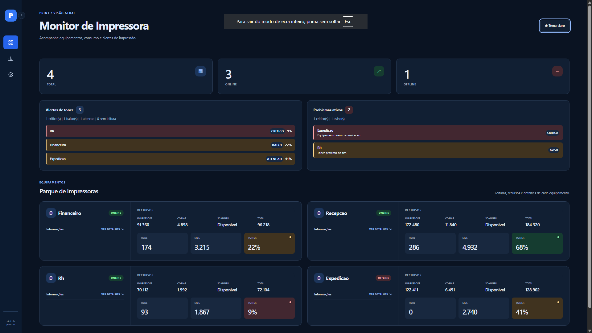
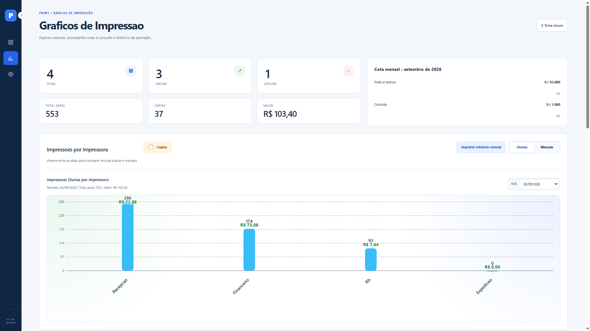

# Monitor de Impressoras

## 1. O que é o sistema

O **Monitor de Impressoras** é uma aplicação web para acompanhar impressoras em rede, consultar o volume de impressões e identificar problemas nos equipamentos. As informações são coletadas por SNMP e armazenadas no MariaDB para consulta de históricos e relatórios.

O sistema oferece:

- Monitoramento de equipamentos online e offline, níveis de toner e problemas ativos.
- Consulta de IP, MAC, número de série, modelo, patrimônio, localização e tempo de atividade.
- Contadores de impressões e cópias, com indicadores diários e mensais.
- Gráficos, acompanhamento de cotas e estimativas de custo por tipo de impressão.
- Auditoria de trabalhos e relatórios por impressora e usuário.
- Cadastro e exclusão de impressoras pela interface.
- Interface responsiva com temas claro e escuro e preferência salva no navegador.

| Tela | O que você encontra |
|---|---|
| Dashboard | Status, alertas, informações técnicas e contadores |
| Gráficos | Comparações diárias e mensais, histórico, auditoria e relatórios |
| Configurações | Cadastro de impressoras, inventário e status de recebimento de eventos |

Os contadores físicos são coletados diretamente das impressoras. Os dados por usuário dependem dos eventos enviados pelo servidor de impressão, associados ao equipamento pelo padrão de porta `PAPERCUT_<IP>`.

Também existe um **preview com dados fictícios**, para conhecer a interface sem banco de dados ou impressoras na rede.

### Imagens do sistema

**Dashboard - tema claro**


**Dashboard — tema escuro**


**Graficos de impressão**


## 2. Quais tecnologias são utilizadas

| Tecnologia | Utilização |
|---|---|
| Python 3.11 | Backend e versão utilizada na imagem Docker |
| Flask e Jinja2 | Rotas HTTP, API e renderização das páginas |
| HTML, CSS e JavaScript | Interface, temas, filtros e interações, sem framework de frontend |
| SVG | Renderização dos gráficos |
| SNMP e PySNMP | Comunicação e coleta de informações das impressoras |
| MariaDB e PyMySQL | Armazenamento e acesso aos cadastros, contadores e históricos |
| Docker e Docker Compose | Construção da imagem e execução em contêiner |

As versões das dependências estão em [requirements.txt](requirements.txt). A versão da aplicação está em [VERSION](VERSION).

## 3. Como fazer a instalação

### 3.1. Pré-requisitos

Para usar equipamentos reais, você precisa de:

- Git para obter o projeto.
- Docker com Docker Compose disponível.
- Um servidor MariaDB acessível pela aplicação, com banco e usuário configurados.
- Acesso de rede às impressoras, com SNMP habilitado e a community correspondente.

O [docker-compose.yml](docker-compose.yml) inicia **somente a aplicação**. Ele não cria um servidor MariaDB.

### 3.2. Obter o projeto

```bash
git clone https://github.com/JPlima21/sistemas-impressoras.git
cd sistemas-impressoras
```

Execute os próximos comandos na pasta que contém `docker-compose.yml` e `Dockerfile`.

### 3.3. Preparar o MariaDB

Crie um banco para o sistema e um usuário com acesso a ele. Esse usuário precisa poder consultar e gravar dados, além de criar e alterar tabelas.

O banco deve existir antes da primeira inicialização. A aplicação cria suas tabelas automaticamente, incluindo `printer_config`, que armazena os cadastros das impressoras.

Verifique se o MariaDB aceita conexões provenientes do ambiente onde o contêiner será executado.

### 3.4. Configurar o arquivo `.env`

Crie um arquivo chamado `.env` na raiz do projeto, ao lado de `docker-compose.yml`, com este conteúdo de exemplo:

```dotenv
# Servidor MariaDB acessível pelo contêiner
MARIADB_HOST=192.168.0.10
MARIADB_PORT=3306
MARIADB_USER=MonitorUser
MARIADB_PASSWORD=substitua_pela_senha_do_banco
MARIADB_DATABASE=monitor_impressoras

# Autenticação HTTP Basic da API
API_USER=admin
API_PASSWORD=substitua_pela_senha_da_api

# Horário de fechamento diário do histórico
HISTORICO_FECHAMENTO_DIARIO=23:59

# Origens adicionais permitidas, separadas por vírgula, se necessário
CORS_ORIGINS=

# Modo de depuração desativado
FLASK_DEBUG=0
```

Substitua o endereço, o nome do banco e as credenciais pelos valores do seu ambiente. Dentro do contêiner, `localhost` aponta para o próprio contêiner; use um endereço do MariaDB acessível a partir dele.

O Docker Compose lê o `.env` e repassa as variáveis declaradas no bloco `environment` à aplicação. O fuso horário está definido no `docker-compose.yml` como `America/Fortaleza`; ajuste esse campo se necessário.

Quando `API_USER` e `API_PASSWORD` estão preenchidos, as rotas `/api` exigem autenticação HTTP Basic. Não versione o `.env` nem credenciais reais. Em produção, publique o acesso com HTTPS.

Não é necessário definir `IMPRESSORAS_CONFIG_JSON`: o código atual não utiliza essa variável. As impressoras são cadastradas pela interface e persistidas no MariaDB.

### 3.5. Iniciar a aplicação

```bash
docker compose up -d --build
```

Confira o serviço e consulte os logs:

```bash
docker compose ps
docker compose logs --tail=100 monitor-impressoras
```

Acesse **http://localhost:8080** no computador que executa o Docker. De outro computador, use `http://IP_DO_SERVIDOR:8080`, desde que a porta esteja liberada na rede.

Se o serviço não iniciar, confira nos logs o endereço do MariaDB, as credenciais, a existência do banco e as permissões do usuário.

### 3.6. Cadastrar as impressoras

Abra **Configurações** e informe o IP, a community SNMP e o tipo de token de impressão. O identificador interno é opcional: se ficar vazio, o sistema gera um automaticamente.

Após o cadastro, acompanhe o equipamento no **Dashboard**. O nome e os demais dados técnicos serão preenchidos conforme as respostas SNMP.

Para exibir trabalhos por usuário, configure também o envio de eventos do servidor de impressão. O cadastro do equipamento, sozinho, não fornece esses eventos.

### 3.7. Parar ou atualizar o serviço

Para parar os contêineres do projeto:

```bash
docker compose down
```

Depois de atualizar os arquivos do projeto, reconstrua e inicie a aplicação:

```bash
docker compose up -d --build
```

Os dados permanecem no MariaDB externo, que deve ter sua própria rotina de backup.

### 3.8. Executar somente o preview

Para avaliar a interface sem MariaDB ou SNMP, use [preview_app.py](preview_app.py), disponível nesta versão de trabalho. Esse modo requer Python e Flask; Docker não é necessário.

Na pasta do projeto, execute:

```bash
python -m pip install Flask==3.1.3
python preview_app.py
```

Acesse **http://localhost:8081** e mantenha o terminal aberto. Para encerrar, pressione **Ctrl+C**. O preview escuta apenas no computador local.

Esse modo usa dados fictícios. Cadastros e exclusões ficam na memória e são descartados ao encerrar o processo. As credenciais e a configuração do banco no `.env` não são utilizadas pelo preview.

